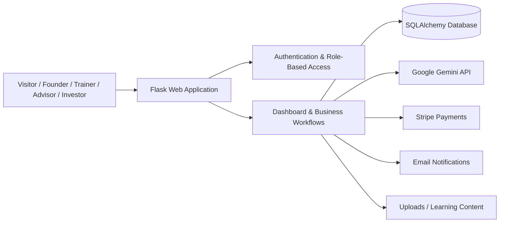

# Nawatech Platform

AI-powered digital business incubator platform for entrepreneurs, trainers, advisors, investors, and administrators.

**Live product:** https://nawatech.org/

> This repository is a sanitized public portfolio snapshot. Production databases, credentials, user uploads, identity documents, private submissions, and proprietary training media are intentionally excluded.

## Overview

Nawatech is a multi-role entrepreneurship platform that supports the full incubation journey: startup applications, training, mentoring, evaluation, funding workflows, payments, certificates, dashboards, and AI-assisted guidance.

The platform combines a Flask backend, role-based workflows, SQLAlchemy models, Stripe payments, email notifications, and Google Gemini integrations for intelligent assistance and content generation.

## My Role

I worked across the product as a **Full-Stack / Backend & AI Developer**, including:

- Designing and implementing the public-facing UI and role-based dashboards.
- Building backend workflows with Flask, Blueprints, SQLAlchemy, and Flask-Login.
- Designing data models for users, startups, programs, applications, courses, mentoring, funding, certificates, evaluations, and purchases.
- Implementing role-based access and verification flows for founders, trainers, advisors, investors, and administrators.
- Integrating Google Gemini for the Nawatech AI assistant and AI-assisted training tools.
- Integrating Stripe checkout and webhook-based payment confirmation.
- Implementing transactional email notifications.
- Building file upload, training progress, project review, mentoring, evaluation, reporting, and certificate workflows.

## Core Architecture



## AI Features

### Nawatech AI Assistant

The platform includes a contextual AI assistant powered by **Google Gemini**.

The assistant adapts its behavior based on the current user role:

- **Visitors:** answers entrepreneurship questions and explains how to join the platform.
- **Founders:** provides guidance based on their projects, open programs, progress, and application status.
- **Trainers:** assists with project evaluation, training plans, and risk-analysis workflows.
- **Advisors:** supports deeper business and investment analysis.
- **Investors:** explains project evaluation and platform investment workflows.

### AI-Assisted Training

Trainer workflows include Gemini-powered endpoints for:

- Generating structured lesson content.
- Generating multiple-choice quizzes in JSON format.
- Producing startup risk-analysis matrices.

## Platform Roles

- **Founder / Entrepreneur**
- **Trainer**
- **Business Advisor**
- **Investor / Funding Entity**
- **Administrator**
- **Public Visitor**

## Main Features

### Startup Applications

Entrepreneurs can create startup profiles, apply to incubation programs, submit project information, track application status, and progress through the incubation journey.

### Training & LMS

Trainers can create courses and lessons containing text, video, PDF, images, links, and quizzes. The platform tracks founder learning progress and supports AI-generated training content.

### Mentoring & Advisory

The platform supports mentoring sessions, trainer-to-advisor project sharing, advisor reviews, feedback, and startup evaluation workflows.

### Risk Analysis & Evaluation

Startup ideas can be evaluated through structured workflows, with Gemini used to generate a formatted risk-analysis matrix based on startup data.

### Investor Portal

Investors and funding entities can review eligible projects and interact with investment-related workflows inside the platform.

### Payments

Stripe is integrated for paid services, including checkout creation and webhook verification. Successful payments can trigger transactional email notifications.

### Administration

Administrative workflows cover users, verification, programs, applications, services, purchases, startups, permissions, reporting, and operational settings.

## Tech Stack

| Area | Technologies |
|---|---|
| Backend | Python, Flask, Flask Blueprints |
| Database | SQLAlchemy, Flask-SQLAlchemy, Flask-Migrate |
| Authentication | Flask-Login |
| AI | Google Gemini API / `google-generativeai` |
| Payments | Stripe API, Stripe Webhooks |
| Frontend | Jinja2, HTML, CSS, JavaScript |
| Email | Flask-Mail |
| Localization | Flask-Babel |
| Documents | ReportLab, QRCode, Pillow |
| Security | bcrypt, environment-based secrets |

## Project Structure

```text
.
├── app.py                  # Application factory, public routes, payments, mail
├── config.py               # Environment-based configuration
├── models/                 # SQLAlchemy data models
├── routes/
│   ├── auth.py             # Authentication and registration
│   ├── dashboard.py        # Founder/admin workflows and AI assistant
│   ├── advisor.py          # Advisor workflows
│   ├── trainer.py          # Trainer, LMS and AI-generation workflows
│   └── investor.py         # Investor/funding workflows
├── services/
│   └── ai_engine.py        # Internal scoring/training/certificate services
├── templates/              # Public site and role-based UI templates
├── static/                 # Public assets
├── .env.example            # Safe environment variable template
├── .gitignore
├── SECURITY.md
└── requirements.txt
```

## Security & Public Repository Notes

This public repository intentionally excludes:

- Production databases and user records.
- Identity documents and private uploads.
- API keys, payment secrets, email passwords, and session secrets.
- Internal test-account credentials.
- Client/startup submissions and private business documents.
- Large proprietary training media.

All external credentials are loaded from environment variables. See `.env.example` for the expected configuration.

## Local Setup

```bash
git clone https://github.com/hassanA176/nawatech-platform.git
cd nawatech-platform
python -m venv .venv
```

Activate the virtual environment, then install dependencies:

```bash
pip install -r requirements.txt
```

Create your local environment file:

```bash
cp .env.example .env
```

Add your own development credentials and run:

```bash
python app.py
```

## Portfolio Notes

This repository focuses on the technical implementation and architecture while protecting production data and credentials. The live product can be viewed at **https://nawatech.org/**.

## Author

**Hassan Ali Hassan**  
AI Engineer & Data Analyst  
Backend Development · API Integration · AI Systems · Automation
